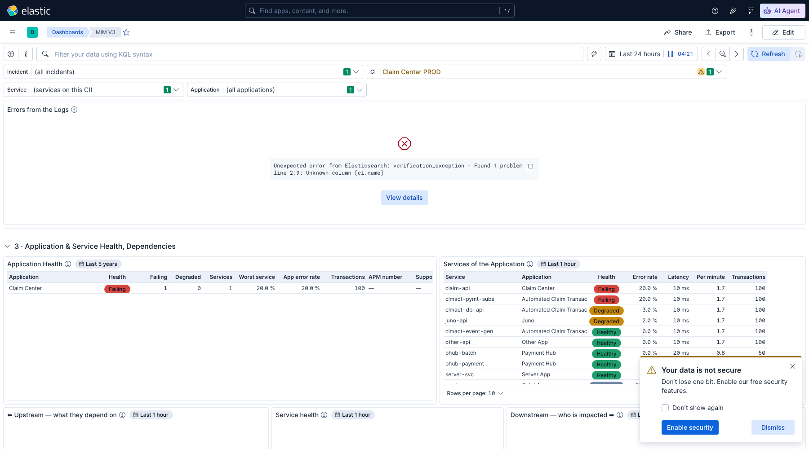

# MIM V3 — Application Health follows the CI, production only, Short description, Changes moved (16 Oct 2026)

Pushed to main. To see the changes on the cluster: import `MIM V3.ndjson` (overwrite), then **More → Reset changes**
and reload. Checked on Kibana / Elasticsearch **9.5.3**.

## 1. Your question: what did Application Health show?

**Before this change it ignored both controls.**
- It did **not** follow the Incident control, and it did **not** fall back to the CI control.
- It always listed every production business application with APM data in the last hour, whatever was selected.
- The Application control only filtered the table next to it, *Services of the Application*.

## 2. Application Health now follows the selected CI

I agree it is more useful this way: pick the incident, and section 3 starts with the applications behind that CI.

| Selected | Application Health lists |
|---|---|
| An incident (Incident control) | The applications related to the incident's CI |
| No incident, a CI (CI control) | The applications related to that CI |
| Nothing | Every production business application, as before |

"Related" means any of these:
- **CMDB:** business applications linked to the CI in the CMDB, in either direction. Example: *Claim Center*, which
  consumes *Claim Center PROD*.
- **APM:** applications whose APM services run on the CI, when the CI is a server.
- **The CI itself:** when it is a business application.

Health is still worked out over **the last hour**. The panel shows a "Last 5 years" badge only because it also reads
the CMDB links, which are re-sent only when they change. The query itself keeps APM data to the last hour.

**Unchanged:**
- *Services of the Application* still follows the **Application** control. To see an application's services, pick it
  there.
- The service panels below (Upstream, Service health, Downstream, Applications getting errors) still follow the CI
  through the Service control's *(services on this CI)*.

**Limit:** an application linked to the CI only through an application service, two steps away in the CMDB, is not
included, unless its APM services run on the CI.

## 3. Production only

Production means an environment value that starts with **"prod" or "prd"**, in any case: *Production*, *Prod*,
*PROD*, *prd1*, *prd2*.

| Panel | What is kept |
|---|---|
| Applications related to this CI, Middleware / Database / Server View, Other related CIs | Production related CIs, plus those with **no environment recorded** (shown "—") |
| Blast radius | Production applications, plus those with no environment recorded |
| Applications on this CI | Production APM services only |
| Open Alerts with No Incident | Alerts on production CIs, plus alerts whose node is not in the CMDB (no environment known) |
| Section 3 (APM) | Already production only (prd1, prd2, prd, prod, production) |

Two choices to confirm:
- **CIs with no environment recorded are kept.** Many CMDB items have no environment (IP addresses, disks, network
  gear). Dropping them would bring back the blind spots fixed in the last round. Say if you would rather hide them
  too.
- **The selected incident or CI itself is never hidden.** *Escalate*, *Alerts on this CI*, the health panels and
  *Changes* show the CI you picked, whatever its environment. Its *Env* column in Escalate tells you if it is not
  production.

## 4. Active Incidents: Short description is back

As the last column, from the incident's short description in ServiceNow.

## 5. Changes in the Last 7 Days on this CI moved

It now sits right after *Escalate*, so section 2 reads:
1. Escalate
2. Changes in the Last 7 Days on this CI
3. Alerts on this CI
4. Blast radius · Applications related to this CI
5. The related-CI views
6. The health panels, then Logs

## Checks

- All eleven tests pass on Elasticsearch 9.5.3, including the new `tools/test_mim_v3_2026-10-16j.py`. It covers:
  - Application Health for an application-service CI, a server CI, a business-application CI, the incident path and
    no CI;
  - non-production rows dropped and blank environments kept;
  - *Short description* back;
  - the new position of *Changes*.
- The link check on Kibana 9.5.3 passes: the Application column of *Application Health* still opens ServiceNow.
- Running the patch scripts on the colleague's export rebuilds `MIM V3.ndjson` byte for byte.
