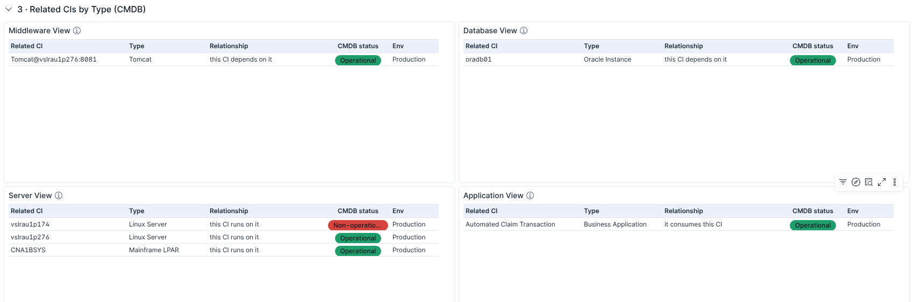
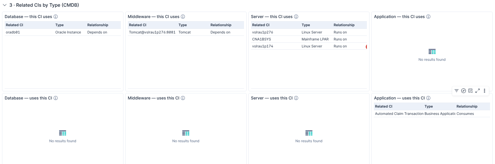

# MIM V3 — changes on 15 Oct 2026, decisions and open questions

## What was done

Starting from the colleague's `updated mim dashboard.ndjson` (kept unchanged); the result is `MIM V3.ndjson`.
Details: *MIM-V3-REVIEW-UPDATED-DASHBOARD.md*.

**Section 3 · Related CIs by Type (CMDB)** — the colleague's four views, fixed:
- Each view matches the exact ServiceNow classes from Round 10 (Database View no longer lists everything;
  Kubernetes, Docker and containers are out of Middleware).
- The views follow the picked incident's CI, or the CI control, like section 2. The extra filter control and its data
  view are removed, so nothing else can be blanked.
- Both directions are shown: "this CI runs on it" or "it runs on this CI", with the relationship and a CMDB status
  badge (non-operational first). The CI itself no longer appears in its own list.
- Nothing is read until a CI is picked (no more scans of the whole 10.6 M-record index).

**Section 4 · Application & Service Health, Dependencies** — new top row:
- **Application Health**: every production business application rated by its services over the last hour, worst
  first — Failing / Degraded / Healthy, how many services are failing or degraded, worst service error rate,
  application error rate, transactions, APM number, support group. Click an application to open it in the CMDB.
- **Services of the Application**: the services of the application picked in the new **Application** control (fourth
  control), worst first, with error rate, latency and throughput. Click a service to open its APM Service Map.

**Dashboard settings**: default time back to the last 24 hours; all sections open expanded; sections renumbered 1–5.

Tests pass (this round and the 14 Oct round), all link columns still work under the Kibana 9.5 rule, and the views
are confirmed not to be emptied by Kibana's time filter. Not yet tried on the 9.5.3 cluster.

## Answers and decisions

1. **Server classes too small to read in the image** — ISAM Server and F5 BIG-IP as "Load Balancer" are included.
   *Confirmed.*
2. **DB2** — there is no "DB2 Subsystem" class in the data, so DB2 Instance is used. *Confirmed.*
3. **Clickable names in the four views** — *decided: keep the four views* (comparison below).
4. **Noise in Application Health** — *decided:* a service needs **at least 20 transactions in the hour** before its
   error rate can mark it, or its application, Failing or Degraded. Below that it shows as **Low traffic** (grey) in
   *Services of the Application*, with its error rate still visible, but it does not count towards the application's
   health. Without this, one failed call out of two reads as "50 % failing". The figure is one setting
   (`MIN_TX` in `tools/mim_v3_patch_2026-10-15.py`) and can be changed after a look at real traffic.

## Question 3: four views (now) or eight panels split by direction (clickable)

**Now — four views, names not clickable.** Each view lists both directions in one table, with the CMDB status.

**Split by direction — eight panels, names clickable** (open the CI in the ServiceNow CMDB). Each group gets one panel
for "this CI uses" and one for "uses this CI".

| | Four views (now) | Eight panels (split) |
|---|---|---|
| Name opens the CI in the CMDB | No | Yes |
| Space per table | Half the width | A quarter of the width: the status column is cut off |
| Empty panels | Rare | Usually half of them: most CIs have relations in one direction for a given type |
| Reading | One list per type, the direction in a column | Two lists per type |

**Recommendation:** keep the four views. The CMDB link matters less here because the name can be picked in the CI
control (which shows the CI everywhere on the dashboard), and the split costs space and readability.

## The Python files in `tools/` — what to do with them

**Nothing.** To use the dashboard, import `MIM V3.ndjson` as before (**Stack Management → Saved objects → Import**,
with *overwrite*, then **More → Reset changes** and reload).

The files in `tools/` are the working record of how `MIM V3.ndjson` was changed and checked:
- `mim_v3_patch_*.py` — the exact changes of each round. If someone edits the dashboard in Kibana again and exports
  it (as on 15 Oct), the same changes can be re-applied to that export instead of being redone by hand.
- `test_mim_v3_*.py` — the checks, run against a local test Elasticsearch, not the CNA cluster.
- `link_cols.py`, `check_link_columns.js` — the check that the clickable columns still work on Kibana 9.5.

They are kept in the repo because the earlier versions were lost when the work environment was reset. They can be
moved to a separate branch if they are in the way.

## Update 16 Oct (suggestions2.txt) — done

`tools/mim_v3_patch_2026-10-16.py`, checked by `tools/test_mim_v3_2026-10-16.py`.

| Ask | Done |
|---|---|
| Users impacted: text "Real count to be incorporated from ServiceNow and RUM" | Yes, on a black tile (the 2,500 demo number stays) |
| Remove *Applications impacted* | Yes |
| *Active Incidents (P1 / P2)* columns, in order: Incident, Pri, Affected CI, State, SLA, Assignment Group, Assignee, Assignee Email, Group Manager Name, Manager Email Id; remove Assigned MIM | Yes (from `assigned_to.name` / `.email`, `assignment_group.manager.name` / `.email`). Opened, Age and Short description were not in the list, so they are gone too |
| *Open Alerts with No Incident*: last 24 hours | Yes |
| *Escalate* (Investigate the CI) columns: CI, Active Incident, Priority, Class, Env, CI support group, Assignment Group, Assignee, Assignee Email, Group Manager Name, Manager Email Id; remove Assigned MIM | Yes |
| Remove *CMDB status* from *Applications that depend on this CI* | Yes |
| Remove *What this CI runs on* | Yes |
| First two panels on a black background | Yes: *Active P1 / P2* is now a Vega donut on black (Kibana's standard charts cannot take a background colour), *Users impacted* on black; text in white, P1 red, P2 amber |

