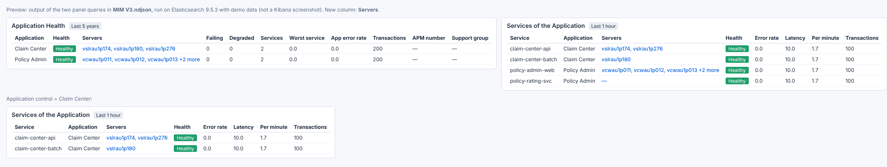

# MIM V3 — changes on Friday 16 Oct 2026, and what is left on the cluster

## Changes (from the updated `suggestions2.txt`)

| # | Request | What changed |
|---|---|---|
| 1 | Users impacted text | The tile reads **"Real count to be incorporated from ServiceNow and RUM"** under the 2,500 demo number. |
| 2 | Remove Applications impacted | Removed from section 1. |
| 3 | Active Incidents columns | Exactly these ten columns: Incident, Pri, Affected CI, State, SLA, Assignment Group, Assignee, Assignee Email, Group Manager Name, Manager Email Id. Assigned MIM, Opened, Age and Short description are gone. |
| 4 | Open Alerts with No Incident, 24 hours | The panel looks at the last 24 hours. **Limit:** an open incident that was not updated in the last 24 hours is not seen, so its alerts can show as "no incident". |
| 5 | Investigate the CI (Escalate) columns | Eleven columns: CI, Active Incident, Priority, Class, Env, CI support group, Assignment Group, Assignee, Assignee Email, Group Manager Name, Manager Email Id. Assigned MIM is gone. |
| 6 | Remove CMDB status | Removed from *Applications that depend on this CI*. |
| 7 | Remove What this CI runs on | Removed; *Applications that depend on this CI* is widened to fill the row. |
| 8 | First two panels black | *Active P1 / P2* (donut) and *Users impacted* both have a black background. **Replaced in the second round: now transparent.** |

Section 3 keeps the four views (Middleware, Database, Server, Application), as agreed.

**Checks:** the test (`tools/test_mim_v3_2026-10-16.py`) passes on local Elasticsearch / Kibana 9.4.1, the link
check passes, and screenshots were taken. Nothing has been checked on the 9.5.3 cluster yet.

## Re-check of the current version (16 Oct, later)
The cluster still has this version, and `MIM V3.ndjson` in the repo is byte-for-byte the 16 Oct version
(commit `9886491`). Re-checked against local Elasticsearch / Kibana 9.4.1:

- All three tests pass: 14 Oct (15 checks), 15 Oct (18 checks), 16 Oct (13 checks). The 14 Oct test was updated
  because *Active P1 / P2* became a Vega donut on 16 Oct; it now runs the donut's own query.
- All link columns are real fields, so Kibana 9.5 allows the links.
- All 31 queries (panels, both Vega panels, four controls) parse. 21 run with the small test data. The other 10 stop
  only on "Unknown column" / "Unknown index", because the test data does not include those fields: Time to Resolve,
  Open Alerts with No Incident, Alerts on this CI, Process, Synthetics, Logs, Changes, Upstream, Downstream, Business
  applications impacted. None of these were changed on 16 Oct, and they read the real fields on the cluster.
- The dashboard imports cleanly; the top row shows the black donut and Users impacted tile, and Active Incidents shows
  the ten columns.

So nothing in the dashboard file needs changing. What is left is on the cluster side, below.

## Second round (16 Oct, later)

| # | Request | What changed |
|---|---|---|
| 1 | Remove the "CMDB status" column | Removed from the four section 3 tables: **Middleware View, Database View, Server View, Application View**. The hidden sort that put non-operational CIs first went with it; rows are now sorted by type, then name. *Relationship* takes the freed width. (*Applications that depend on this CI* lost its CMDB status in the first round.) |
| 2 | First two panels transparent, not black | *Active P1 / P2* and *Users impacted* have no background. Their text takes Kibana's theme colours, so it reads in both light and dark mode. The donut now uses the same red / amber as the priority badges in *Active Incidents*; the old yellow could not be read on a white page. Preview: `mim-v3-first-row-transparent-preview.png` |
| 3 | Test walkthrough | **`MIM-V3-TEST-WALKTHROUGH.md`**: eight steps from picking an incident to finding the likely cause and escalating to the assignee or the group manager, each with what you should see, plus a test record to fill in |
| — | Found while checking | Three panel descriptions still named removed panels (*Active P1 / P2 at a Glance*, *What this CI runs on*) or the old section number of the Infra Dashboard card; corrected |

Checks: all four tests pass (`tools/test_mim_v3_2026-10-14.py`, `-16.py`, `-15.py`, new `-16b.py`). The first row was
checked in Kibana's light and dark themes. Running the three patch scripts on the colleague's export rebuilds
`MIM V3.ndjson` byte for byte.

## Fourth round: P3 incidents included (16 Oct, later)

Requested so that more CIs, with more telemetry, can be picked for demos.

| Where | What changed |
|---|---|
| **Incident** and **CI** controls | List P1, P2 and P3 incidents (and their CIs) |
| **Active P1 / P2 / P3** (donut, renamed) | Counts P3 too, in blue |
| **Active Incidents (P1 / P2 / P3)** (renamed) | Lists P3s; a P3 that has a ServiceNow SLA record shows its real SLA status. A P3 **with no SLA record** shows **"No SLA record"**, because there is no agreed P3 target to compare its age with (P1 4 h / P2 8 h unchanged) |
| **Escalate** | Shows the people for a P3 as well |
| Priority badges | P3 has its own colour (blue) in Active Incidents and Escalate |
| **P1 / P2 Time to Resolve vs Target** | Unchanged in this round; P3 added in the fifth round below |

Preview with test data: `mim-v3-p3-preview.png`. Checks: all five tests pass, including the new
`tools/test_mim_v3_2026-10-16d.py` (a P3 with and without an SLA record; a P4 and a resolved P3 stay out). Rebuilding
from the colleague's export with the four patch scripts gives the same file byte for byte.

## Fifth round: P3 target 24 h, Time to Resolve fixed (16 Oct, later)

| Where | What changed |
|---|---|
| **P1 / P2 / P3 Time to Resolve vs Target (P1 4 h · P2 8 h · P3 24 h)** (renamed) | P3 added, with a blue dashed 24 h line. The time axis was made **logarithmic** (replaced in the seventh round by two axes from 0 h, because the log axis cut off values under 1 h) |
| Same chart — **the live P1 that did not show** | Two causes. (1) The chart only plotted **resolved** incidents, so an open P1 had no point until it was resolved. Now an open incident counts with its **age so far**: it appears on the day it was opened and its point climbs past the target while it stays open. (2) Kibana's "auto" point setting can hide a priority that has incidents on one day only (a single point with no line); points are now always drawn |
| Same chart — counting | Each incident counts once. An incident synced several times used to weigh once per copy in the day's average. Canceled incidents are left out |
| **Active Incidents** SLA column | A P3 with no ServiceNow SLA record is compared with **24 h** and marked "(age)", like P1 4 h / P2 8 h ("No SLA record" is gone) |

Preview with test data (a live P1 opened 6 h ago at the far right, above its 4 h line; a P2 resolved on one day only):
`mim-v3-time-to-resolve-p3-preview.png`. Checks: all six tests pass, including the new
`tools/test_mim_v3_2026-10-16e.py` (an incident synced three times counts once, the live P1 is plotted by its age,
canceled and P4 left out).

## Sixth round: the donut showed only P3 (16 Oct, later)

Seen live: the Active Incidents table had active P2 and P3, but the *Active P1 / P2 / P3* donut showed only P3.
Details, before / after images and a query to confirm it on the cluster: *MIM-V3-TIME-TO-RESOLVE-AND-DONUT.md*.

| What changed | Why |
|---|---|
| Every priority with an active incident gets at least 6 % of the ring | With many P3s, a P2 slice was thinner than the gap between slices and was not drawn at all (reproduced: 1 P2 next to 300 P3s gave a solid blue ring) |
| The legend always lists P1, P2 and P3, 0 shown faded | A priority with no incidents used to disappear instead of reading 0 |
| The donut uses the same active-incident rule as the Active Incidents table | So the two panels always count the same incidents |

Checks: all seven tests pass, including the new `tools/test_mim_v3_2026-10-16f.py` (donut and table give the same
counts; duplicates, a resolved P2, a P4 and a non-incident number left out).

## Seventh round: donut still wrong on the cluster; Time to Resolve from 0 h (16 Oct, later)

Reported with `bad_donut.png`: the donut read **P2 0** while the Active Incidents table listed active P2s; and the
Time to Resolve log axis started at 1.0 h, cutting off lines that went below it. Details and before / after images:
*MIM-V3-TIME-TO-RESOLVE-AND-DONUT.md*, part 5.

| What changed | Why |
|---|---|
| The donut has a fixed panel time range, **Last 1 month**, the same as Active Incidents | **Kibana 9.5 applies the dashboard's time range to Vega ES\|QL queries by itself** (9.4, used for testing until now, did not). With the dashboard on "Last 24 hours", the donut only counted incidents whose record was updated in the last 24 h, so long-running On Hold P2s were missing. Reproduced on Kibana 9.5.3 |
| Time to Resolve: normal axes from **0 h**; P1 and P2 on the left axis, P3 on its own right axis | The log axis could not show values under 1 h. On a single 0-based axis, P3's day-plus values would flatten P1 and P2 |

**Now tested on Kibana / Elasticsearch 9.5.3** (images pulled from Docker Hub): all eight tests pass and every link
column is a real field on 9.5.3. The Incident control was checked too: it lists incidents not updated in the last 24 h,
so 9.5's time handling does not affect the controls.

## Eighth round: related-CI views moved into "Investigate the CI" (16 Oct, later)

| What changed | Where |
|---|---|
| *Middleware View*, *Database View*, *Server View* and *Application View* moved into **2 · Investigate the CI**, right after *Blast radius* and *Applications that depend on this CI* | The health panels, Logs and Changes move down below them |
| The empty **3 · Related CIs by Type (CMDB)** section removed | Sections are now 1 · Major Incident Overview, 2 · Investigate the CI, **3** · Application & Service Health, Dependencies, **4** · Related dashboards |
| Three panel descriptions that named a section by number | Updated, and the guide and walkthrough renumbered |

Checked on Kibana 9.5.3 (panel order and section titles); all nine tests pass, including the new
`tools/test_mim_v3_2026-10-16h.py`.

## Ninth round: no blind spots in related CIs; one applications table; "Times fired" (16 Oct, later)

Details, the reasons and screenshots: *MIM-V3-RELATED-CIS-NO-BLIND-SPOTS.md*.

| What changed | Why |
|---|---|
| The related-CI panels read **`cmdb-ci-relations*`**, the full ServiceNow relationship graph, instead of `cmdb_app_dependencies_v2` | The extract missed many relationships that ServiceNow shows |
| **Applications related to this CI** replaces *Applications that depend on this CI* and *Application View*: every application, both directions | They overlapped (e.g. *Claim Center* "consumes this CI" was in both), and the old name hid that some rows are applications the CI itself uses |
| **Other related CIs** (where *Application View* was): every related CI whose class is in none of the lists | Classes outside the Middleware / Database / Server lists appeared nowhere |
| Retired CIs shown, marked "· retired", listed last; links marked for deletion left out | Retired CIs were hidden |
| CI name matched exactly, in UPPER and in lower case | A different case missed the match |
| Fixed range **Last 5 years** on these panels | Relationship records are only re-sent when they change (oldest 2023); the time picker hid most of them |
| *Blast radius* counts from the same graph | So it agrees with the table |
| **"Count" → "Times fired"** in *Open Alerts with No Incident* and *Alerts on this CI* | Clearer name; same Netcool tally |

Trade-off: the Application column of the merged table no longer opens ServiceNow (Kibana 9.5 blocks links on a name
taken from either side of a link). Checked on Kibana / Elasticsearch 9.5.3; all ten tests pass, including the new
`tools/test_mim_v3_2026-10-16i.py`.

## Tenth round: Application Health follows the CI; production only; Short description; Changes moved (16 Oct, later)

Details: *MIM-V3-APP-HEALTH-BY-CI-AND-PROD-ONLY.md*.

| What changed | Detail |
|---|---|
| **Application Health** follows the selected CI | Applications related to the incident's CI (or the CI control): CMDB-linked business applications, applications with APM services on the CI, or the CI itself. All production applications when nothing is selected. It ignored both controls before |
| **Production only** | Related-CI tables, Blast radius, Applications on this CI, Open Alerts with No Incident: environment starting "prod" / "prd" (any case). Blank environments kept; the selected CI itself never hidden |
| **Short description** back in Active Incidents | Last column |
| **Changes in the Last 7 Days on this CI** right after Escalate | Section 2 order: Escalate, Changes, Alerts, Blast radius / Applications, views, health, Logs |

All eleven tests pass on 9.5.3, including the new `tools/test_mim_v3_2026-10-16j.py`.

## Eleventh round: Server control and Health window (18 Oct)

Plan: *MIM-V3-BUILD-PLAN-SERVER-HEALTH-WINDOW.md*. Summary: *MIM-V3-SUMMARY-SERVER-CONTROL-PHASE1.md*.

| What changed | Detail |
|---|---|
| **Controls** | Incident · CI · **Server** (new) · **Health window** (new) · Service · Application |
| **CI control** | Also lists every production server that sent CPU metrics in the last day |
| **Which server** | Incident's CI if a server, else the CI control's value if a server, else the Server control's value |
| **Health window** | 15 min … 7 days, default 24 hours, applied inside the queries of Server, Middleware, Database, Process Health, Synthetics, Logs and Applications on this CI. The time picker no longer changes them |
| **Server Health** | A table, one row per server: Status (Reporting / Silent / No data in window), minutes ago, CPU p90, memory peak, fullest disk |
| **Alerts on this CI** | Also the chosen server's alerts; still a fixed 7 days |
| **Not built** | Automatic servers for an application CI (step 4): too heavy for this cluster (Round 11); you chose to keep phase 1 only. See *MIM-V3-AUTOMATIC-SERVERS-DECISION.md* |

All twelve tests pass on 9.5.3, including the new `tools/test_mim_v3_2026-10-18k.py`.

## Twelfth round: Servers column in section 3 (18 Oct)

| What changed | Detail |
|---|---|
| **Application Health** | New *Servers* column after Health: the hosts its services' APM agents reported from in the last 15 minutes. Its description now explains the "Last 5 years" badge (CMDB links only; APM data is read for the last hour) |
| **Services of the Application** | New *Servers* column after Application, per service. One row per service (a service with two applications shows both names) |
| **Also** | *Errors from the Logs* notes that a 3- or 7-day Health window can load slowly the first time (Round 11d) |

All thirteen tests pass on 9.5.3, including the new `tools/test_mim_v3_2026-10-18m.py`.

## What is left to do on the cluster

### 1. Import the dashboard (needed again: the second and fourth to twelfth rounds changed it)
1. Stack Management → Saved objects → Import `MIM V3.ndjson`, choosing **overwrite**. It replaces the colleague's
   version (same dashboard id) and adds the new **Application** control.
2. Open the dashboard, then **More → Reset changes** and reload the page, so Kibana drops any unsaved layout it kept
   from the old version.

### 2. Optional clean-up
- The colleague's data view `cmdb_app_dependencies_v2` (id `1e5c8fab-f6d6-4546-8fd1-b54ac1281ad5`) is no longer used
  by the dashboard. Delete it only if nothing else uses it (Saved objects → the data view → Relationships).

### 3. Viewer access
Viewers need read access to every index the panels read, or the panel shows an error instead of "no results":

| Data | Indices |
|---|---|
| ServiceNow | `servicenow-incidents-*`, `servicenow-task-sla-*`, `servicenow-change-requests-*` |
| CMDB | `cmdb-ci-relations*` (since the ninth round the dashboard no longer reads `cmdb_app_dependencies_v2`) |
| Netcool alerts | `.ds-bridge-alerts-netcool-default-*` (hidden backing indices) |
| Server metrics | `.ds-metrics-system.cpu-default*`, `.ds-metrics-system.memory-default*`, `.ds-metrics-system.filesystem-default*` (hidden), `metrics-system.process-*`, `metrics-windows.service-*`, `metricbeat-*` |
| APM | `metrics-apm.service_transaction.1m-*`, `metrics-apm.service_destination.1m-*`, `metrics-apm.internal-*`, `traces-apm*`, `logs-apm.app.*`, `logs-apm.error-*` |
| Logs | `logs-syslog-classic-*`, `logs-system.syslog-*`, `logs-aix-syslog-*`, `logs-redhat6x-syslog-*`, `logs-websphere-syslog-*`, `logs-jboss-*`, `logs-filestream.generic-*` |
| Synthetics | `synthetics-*` |
| SLOs | `.slo-observability.summary-v3*` (hidden) |

A role that grants `metrics-*` or `logs-*` does not by itself cover the `.ds-…` names that some panels read directly;
grant those patterns too.

### 4. Check on 9.5.3 after the import
- *Active P1 / P2* and *Users impacted* have a transparent background and readable text (both are Vega panels).
- The four section 3 views have four columns: Related CI, Type, Relationship, Env.
- Picking an incident fills sections 2 and 3 with its CI.
- The four views in section 3 fill for a CI that has CMDB relationships.
- The Application control filters *Application Health* and *Services of the Application*.
- Click-through links work in view mode (Active Incidents, Escalate, the CMDB links).
- The Server and Health window controls appear after the CI control; picking a server fills *Server Health* with one
  row, and switching the Health window to 15 minutes changes the health panels.

## Not dashboard changes (need other teams)
- **Live health in the CMDB views:** needs a lookup copy of `cmdb-ci-relations*` (option (b) in *MIM-V3-CI-VS-CMDB-RELATIONSHIPS.md*).
- **Real users-impacted count:** needs ATOS to ingest the ServiceNow / RUM user counts.
- **Exact alert-to-incident link:** needs the Netcool / ServiceNow integration to write the incident number back to the
  alert.
