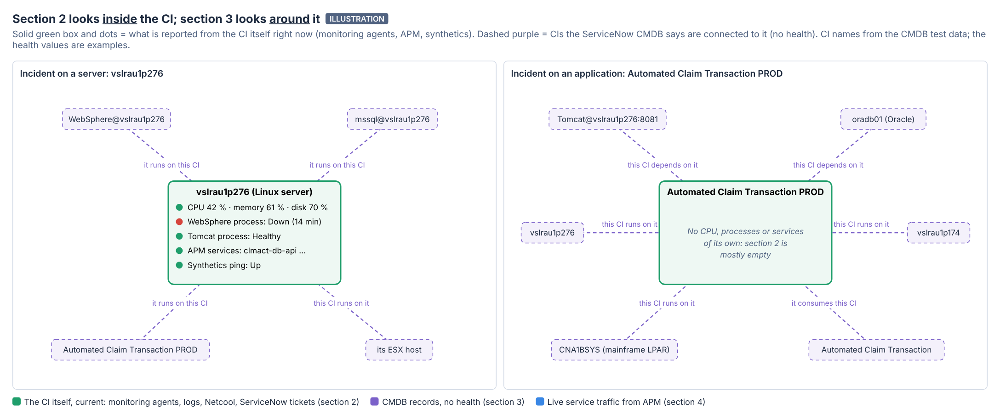
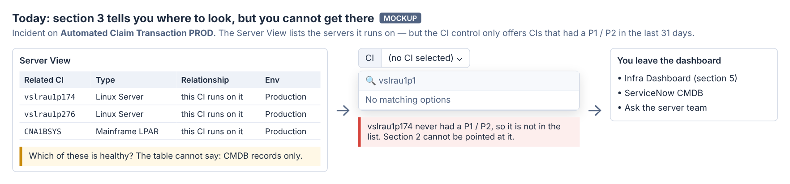
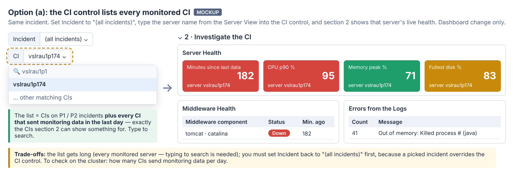
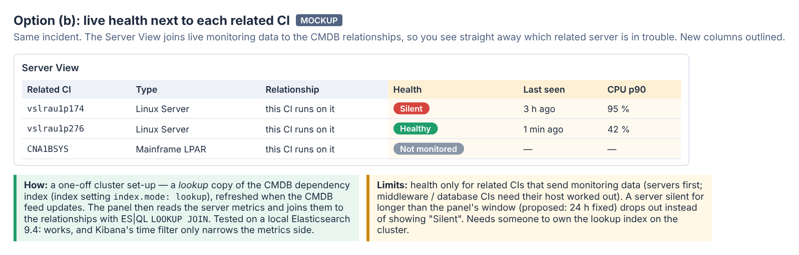
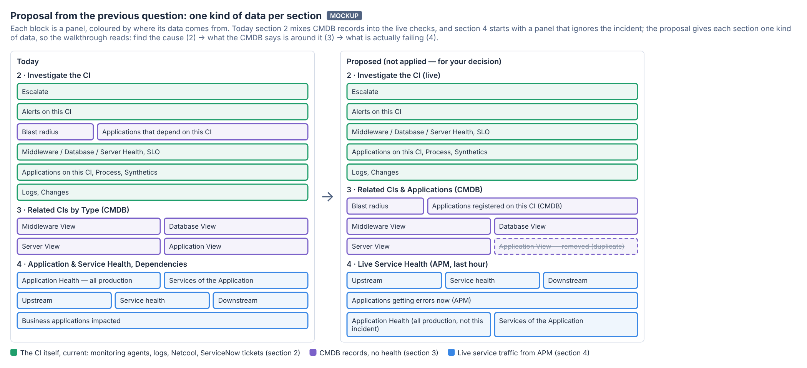

# MIM V3 — "Investigate the CI" vs "Related CIs by Type": what each does, and whether we need both

*16 Oct 2026. Explanation and options only: **nothing in this document has been applied to the dashboard.** The
decisions at the end are yours.*

> **Update, later 16 Oct:** at your request, the four related-CI views moved into section 2 (*Investigate the CI*), right
> after *Blast radius* and *Applications that depend on this CI*; the old section 3 is gone and sections 4 and 5 are now
> 3 and 4. Below, "section 3" means those views and "section 4" means *Application & Service Health*.

## Short answer

- **Section 2 (*Investigate the CI*) looks *inside* the CI.** It shows what is reported from the CI itself right now:
  CPU and disks, processes, services, logs, alerts, tickets. It is live, and it fills for **servers**.
- **Section 3 (*Related CIs by Type*) looks *around* the CI.** It lists the other CIs that ServiceNow's CMDB says are
  connected to it, such as middleware, databases, servers and applications. It is not live, but it fills for **any
  CI**, including applications.
- They **complement** each other:
  - For a server incident, section 2 does most of the work.
  - For an application incident, section 3 is the only map of where the problem could be.
- **Both are needed.** But today section 3 stops at "here is a list of names": you cannot check the health of those
  names without leaving the dashboard. Two ways to fix that are described below.



*Left: a server incident. Section 2 says the WebSphere process is down; section 3 says a WebSphere instance is
registered on the server. That is the same thing from two angles: what should be there, and whether it is running.
Right: an application incident. Section 2 has almost nothing to show, because an application has no CPU or
processes of its own; section 3 lists the Tomcat, Oracle and servers it runs on.*

---

## 1. How the two sections differ

| | **Section 2 — Investigate the CI** | **Section 3 — Related CIs by Type (CMDB)** |
|---|---|---|
| Panels compared here | Middleware Health, Database Health, Server Health, Applications on this CI, Process Health, Synthetics Health | Middleware View, Database View, Server View, Application View |
| Where the data comes from | Monitoring agents (Metricbeat: CPU, memory, disk, processes, Windows services; SQL Server metrics), APM, Synthetics | ServiceNow CMDB relationship records (`cmdb_app_dependencies_v2`) |
| Which CI it is about | The selected CI **itself**, matched on its name or host name | **Other CIs** linked to it, in both directions: "this CI runs on it" and "it runs on this CI" |
| Live? | Yes: up / down, minutes since last seen, CPU %, failed checks | No: the CMDB's record of how things are connected, with no health |
| Answers | "Is something on this box broken right now?" | "What else is involved? Where else should I look? What could this affect?" |
| Fills for | Servers with monitoring agents | Any CI that has CMDB relationships |
| Time picker | Followed (Applications on this CI: fixed 7 days) | Ignored (the CMDB data has no timestamp) |

### Panel by panel

**Section 2: live, about the CI itself**

| Panel | What it shows | Data | Overlaps with |
|---|---|---|---|
| **Server Health** | Minutes since the server last sent data, CPU p90, peak memory, fullest disk | System metrics for the CI | — |
| **Middleware Health** | Each middleware component on the CI (IBM MQ, IHS, JBoss, WebSphere, IIS, Tomcat …): Down / Healthy, minutes since seen | Processes labelled by the monitoring enrichment + Windows middleware services | **Process Health** (same process and service data) |
| **Database Health** | Each database on the CI (SQL Server, Oracle, Db2, PostgreSQL, MySQL …): Down / Healthy | SQL Server metrics + database processes and Windows services | **Process Health** (same process and service data) |
| **Process Health** | Stopped Windows services (set to Automatic but not running), processes not seen for 10 min, then healthy middleware | Windows services + labelled middleware processes | **Middleware / Database Health**: a middleware process can appear in both |
| **Applications on this CI** | APM services that sent data from this server in the last 7 days, with *Last data* | APM | **Service health** in section 4 (the same services, with their error rate over the last hour) |
| **Synthetics Health** | Ping / HTTP monitors that target this CI: up / down, down checks | Synthetics | — |

**Section 3: CMDB, around the CI**

| Panel | What it shows |
|---|---|
| **Middleware View** | Application servers linked to the CI (Tomcat, JBoss, WebLogic, WebSphere …) |
| **Database View** | Databases linked to the CI (Oracle, MS SQL, Db2, MySQL, PostgreSQL, MongoDB …) |
| **Server View** | Servers linked to the CI (Windows, Linux, AIX, ESX, mainframe LPAR, load balancers …) |
| **Application View** | Business applications linked to the CI. **Overlaps** with *Applications that depend on this CI* in section 2, which reads the same CMDB data |

---

## 2. How they work together in an investigation

**Incident on a server** (e.g. `vslrau1p276`):
1. Section 2 first. Is the server alive? Is a process, service or database down? Are there errors in its logs?
2. Then section 3. What is registered on this server, and what does it run on (its ESX host, for example)? This helps
   in two ways:
   - Spot what monitoring does not see: a CI **in the CMDB but missing from section 2** is not monitored, which is a
     blind spot.
   - Spot CMDB gaps: something running in section 2 but **missing from section 3** means the CMDB is out of date.

**Incident on an application** (e.g. *Automated Claim Transaction PROD*):
1. Section 2 is mostly empty. That is expected, not a fault.
2. Section 3 shows where the application runs: its Tomcat, its Oracle database, its Linux servers, the mainframe
   LPAR. The cause is probably on one of those.
3. **Then you get stuck.** See the next part.

---

## 3. Weak points today

### 3.1 Section 3 tells you where to look, but you cannot get there



The **CI control only lists CIs that had a P1 / P2 in the last 31 days**. A related server that never had a major
incident cannot be picked. Section 2 therefore cannot be pointed at it, and the views have no click-through. You end
up in the Infra Dashboard or ServiceNow.

### 3.2 Section 2 repeats itself
- *Process Health* and *Middleware / Database Health* read the same process and Windows-service data, so a middleware
  process can show up twice. What only *Process Health* adds is **stopped Windows services that are not middleware
  or databases**.
- *Applications on this CI* and *Service health* (section 4) list the same APM services. What only *Applications on
  this CI* adds is **services that stopped sending data** (e.g. *Last data: 3 d ago*), which the 1-hour view in
  section 4 cannot show.

---

## 4. Are they needed?

| Panel | Verdict | Why |
|---|---|---|
| Server Health | **Keep** | The core of a server investigation |
| Middleware Health, Database Health | **Keep** | Show what is down on the server, by component |
| Process Health | **Keep, but trim** (decision D4) | Only the non-middleware, non-database stopped services are unique |
| Applications on this CI | **Keep for now** (decision D4) | Overlaps with Service health, but is the only place that shows a service that went silent |
| Synthetics Health | **Keep** | Often empty, but cheap; a down ping is a strong signal |
| Middleware / Database / Server View | **Keep** | The only map for application incidents |
| Application View | **Remove** (proposal, decision D1) | Same CMDB data as *Applications that depend on this CI* |

Section 3 only pays off fully once you can check the health of what it lists. Two options follow.

---

## 5. Option (a): let the CI control list every monitored CI (dashboard change only)



- **What changes:** the CI control lists the CIs on P1 / P2 incidents, **plus every CI that sent monitoring data in
  the last day**. Those are exactly the CIs section 2 can show something for.
- **How you use it:**
  1. Read the server name in the Server View.
  2. Set Incident to "(all incidents)".
  3. Type the server name into the CI control.
  4. Section 2 now shows that server's health, logs, alerts and changes.
- **Effort:** small, a change to one control query. No cluster set-up.
- **Trade-offs:**
  - The list gets long, so you search it by typing.
  - You must clear the Incident control first, because a picked incident overrides the CI control.
- **To check first** (data query, please run on the cluster): how many CIs send monitoring data per day. If it is
  over 10,000, the list needs a narrower source.

  ```
  FROM .ds-metrics-system.cpu-default*
  | WHERE @timestamp >= NOW() - 1 day
  | STATS monitored_cis = COUNT_DISTINCT(ci.name)
  ```

---

## 6. Option (b): show live health next to each related CI (needs a one-off cluster set-up)



- **What changes:** the views get *Health*, *Last seen* and *CPU p90* columns. You see straight away which related
  server is in trouble, without leaving section 3.
- **How it works:**
  - Kibana cannot combine the CMDB index (no timestamp) with timestamped metrics in one panel today.
  - Elasticsearch's **LOOKUP JOIN** can, if the CMDB relationships are also kept in a *lookup* index
    (`index.mode: lookup`).
  - The panel then reads the server metrics and joins the relationships onto them.
- **Tested locally** (Elasticsearch 9.4): the join works, and Kibana's time filter only narrows the metrics side, so
  CMDB rows are not dropped.
- **Cluster set-up needed:**
  1. Create the lookup index.
  2. Keep it in sync with `cmdb_app_dependencies_v2`, from the same feed or a scheduled re-index.
  3. Give viewers read access to it.

  Someone has to own this.
- **Limits:**
  - Health only for related CIs that send monitoring data. Servers come first; middleware and database CIs need their
    host worked out.
  - A server silent for longer than the panel's window (proposed: 24 hours, fixed) drops out instead of showing
    "Silent". The panel can say how many related servers sent no data.
- **Effort:** medium. The cluster set-up above, then a rewrite of the three views.

**Recommendation:** start with **(a)**. It is cheap and removes the dead end. Consider **(b)** once (a) has been used in
real incidents and the lookup index has an owner.

---

## 7. Related: the section reorganisation proposed earlier (not applied)

My answer to your previous question proposed reorganising sections 2–4. You asked to understand it before any
change, so here it is as a picture:



1. **Section 2 holds only live checks on the CI itself.** *Blast radius* and *Applications that depend on this CI*
   (CMDB) move to section 3.
2. **Section 3 becomes "what the CMDB says"**, renamed *Related CIs & Applications (CMDB)*.
   *Applications that depend on this CI* is renamed **"Applications registered on this CI (CMDB)"**.
3. **Application View is removed.** Its business applications are already in that table.
4. **Section 4 becomes "what APM sees live"**, renamed *Live Service Health (APM, last hour)*. It starts with the
   panels that follow the incident. *Business applications impacted* is renamed **"Applications getting errors now
   (APM)"**, to make the difference from the CMDB list obvious.
5. **Application Health** (all of production, not tied to the incident) moves to the end of section 4, renamed
   **"Application Health (all production, not this incident)"**.

The walkthrough would then read: find the cause (section 2) → see what the CMDB says is around it (section 3) → see
what is actually failing (section 4).

---

## 8. Decisions for you

| # | Decision | Options |
|---|---|---|
| D1 | Reorganise sections 2–4 (part 7) | All five changes / some of them (say which) / none |
| D2 | Option (a): CI control lists every monitored CI | Yes, after the count query in part 5 / no |
| D3 | Option (b): live health in the views | Yes, start the cluster set-up / later / no |
| D4 | Section 2 overlaps (part 3.2) | Trim *Process Health* to non-middleware, non-database services / leave as is. Keep *Applications on this CI* / fold it into section 4 |
