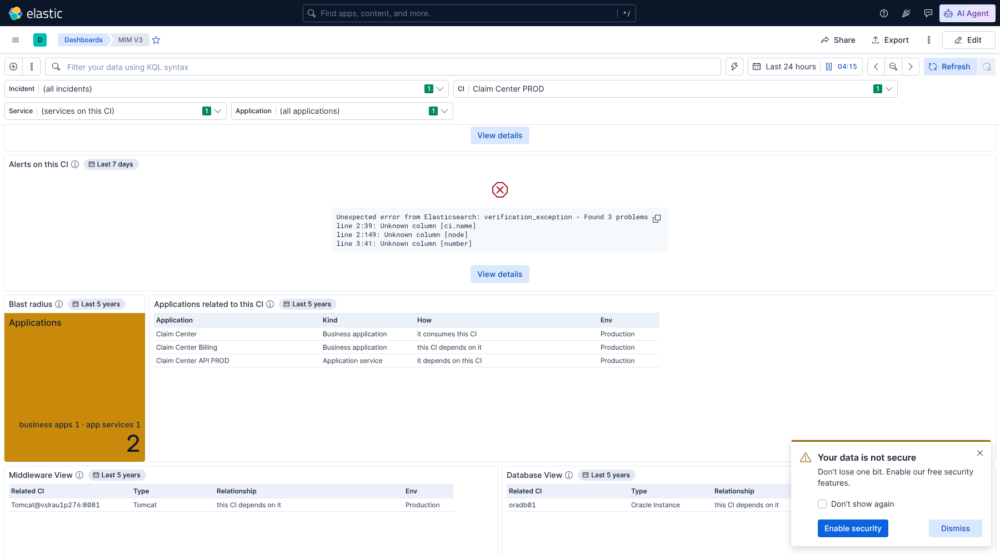
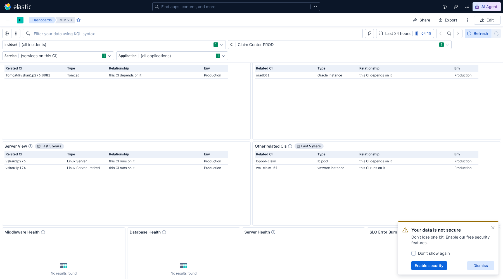

# MIM V3 — related CIs with no blind spots, one applications table, "Times fired" (16 Oct 2026)

Pushed to main. To see the changes on the cluster: import `MIM V3.ndjson` (overwrite), then **More → Reset changes**
and reload. Checked on Kibana / Elasticsearch **9.5.3**.

## 1. Why relationships in ServiceNow were missing

There were four causes, all fixed:

| Cause | Fix |
|---|---|
| **Wrong source.** The views and the applications table read `cmdb_app_dependencies_v2`, an application-dependency extract. It holds only part of the CMDB's relationships. | They now read **`cmdb-ci-relations*`**, the full ServiceNow relationship graph: 34.2 million links, every class, both directions. |
| **Class lists.** Only the classes in the Middleware, Database, Server and Application lists were shown, out of about 275 classes. A related load balancer pool, cluster, VM, network device or disk appeared nowhere. | New table **Other related CIs**, where *Application View* used to be, with every related CI whose class is in none of the lists. |
| **Retired CIs were hidden.** | Retired CIs are shown, listed last and marked **"· retired"** in the Type column. Links that ServiceNow has marked for deletion stay out. |
| **Exact name match.** A CI name stored in a different case was missed. | The name now also matches in UPPER and lower case. |

Relationship records are only re-sent when they change; the oldest go back to 2023. With the dashboard's time picker
(Last 24 hours) most of them would be hidden, so these panels have a fixed range of **Last 5 years**, shown as a badge
next to each title.

## 2. One applications table

You were right: *Application View* duplicated *Applications that depend on this CI*. In your example, *Claim Center*
"consumes" *Claim Center PROD*, so it appeared in both. The old name also hid that the table mixed directions.

The two are now one table, **Applications related to this CI**:
- every business application, application service and application instance related to the CI, **in both
  directions**;
- **How** spells the relationship out:
  - **"it consumes this CI"**, "it depends on this CI": the application uses the CI, so it is impacted if the CI
    fails;
  - **"this CI depends on it"**, "this CI runs on it": the CI itself uses the application;
- business applications first, then application services, then application instances; retired ones last.

*Blast radius* counts, from the same graph, the applications that depend on the CI (the first kind). Its detail
line shows business apps, app services and, when there are any, instances.

**Trade-off:** the Application column no longer opens ServiceNow when clicked. The name now comes from either side of a
relationship, and Kibana 9.5 blocks links on such columns; the four views have had the same limit all along.





## 3. Section 2 now reads

1. Escalate
2. Alerts on this CI
3. Blast radius · Applications related to this CI
4. Middleware View · Database View
5. Server View · Other related CIs
6. Middleware / Database / Server Health · SLO
7. Applications on this CI · Process Health · Synthetics
8. Errors from the Logs
9. Changes

## 4. "Count" is now "Times fired"

In *Open Alerts with No Incident* and *Alerts on this CI*: Netcool's tally of how many times the same alert has fired
since it first appeared. A high number means a recurring or flapping problem; 1 or 2 means a new one.

## 5. To confirm on the cluster: no blind spots left

Compare one CI's related items in ServiceNow with this query. Run it in Discover (ES|QL mode) with the time picker on
**Last 5 years**, replacing the name:

```
FROM cmdb-ci-relations*
| WHERE parent.name == "Claim Center PROD" OR child.name == "Claim Center PROD"
| EVAL down = parent.name == "Claim Center PROD"
| EVAL related = CASE(down, child.name, parent.name), class = CASE(down, child.class, parent.class),
       direction = CASE(down, "this CI → it", "it → this CI")
| STATS links = COUNT(*), examples = VALUES(related) BY class, direction, type.name
| SORT links DESC
```

How to read the result:
- **Every row here appears on the dashboard**, in one of the five tables:
  - *Applications related to this CI*;
  - *Middleware View*, *Database View* or *Server View*;
  - *Other related CIs*.

  The only exception is a link marked for deletion.
- **If ServiceNow lists a relationship that this query does not return,** the relationship is missing from the
  `cmdb-ci-relations` feed itself. That is a data-feed issue for the CMDB integration team, not something the
  dashboard can show.

## 6. Remaining limits

- A CI name stored in **mixed case**, different from the incident's (e.g. "Claim center PROD" against
  "Claim Center PROD"), is still missed. Exact, UPPER and lower case are matched; matching any case would make every
  panel scan all 34 million links.
- Each table shows up to 300 rows (500 for *Applications related to this CI* and *Other related CIs*), with paging.
  A server can have hundreds of disks and IP addresses under *Other related CIs*.
- These panels are CMDB records with **no live health**. Option (b) in *MIM-V3-CI-VS-CMDB-RELATIONSHIPS.md* would add
  it.
- The **Changes** panel still finds changes on linked CIs only when the link was updated in the same 7 days. It reads
  change requests and relationships in one query, so it cannot give them different time windows.
