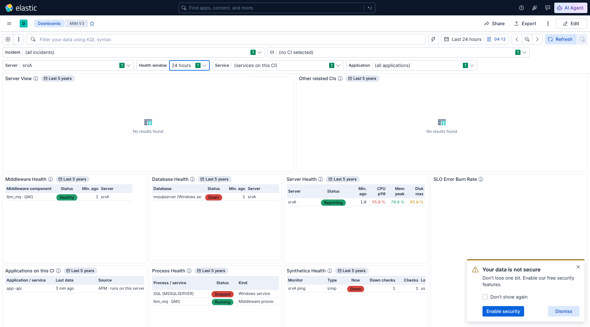

# MIM V3 — summary: Server control and Health window, phase 1 (18 Oct 2026)

Built from the accepted plan (*MIM-V3-BUILD-PLAN-SERVER-HEALTH-WINDOW.md*), steps 1 to 3 of the precedence.
**Step 4, automatic servers, is not built yet**; see the last section. To pick it up: import `MIM V3.ndjson` with
overwrite, then **More → Reset changes** and reload.

*Kibana 9.5.3, test data, Server control = srvA. Server Health is one row: Reporting, CPU p90 95 % (red), memory
70 % (green), disk 85 % (amber).*

## Controls

Order: **Incident · CI · Server (new) · Health window (new) · Service · Application**

| Control | Lists | Default |
|---|---|---|
| **CI** | CIs on P1–P3 incidents in the last 31 days, **plus every production server that sent CPU metrics in the last day** (servers with a blank environment are kept) | (no CI selected) |
| **Server** | Every production server that sent CPU metrics in the last day | (no server selected) |
| **Health window** | 15 minutes · 30 minutes · 1 hour · 6 hours · 8 hours · **24 hours** · 3 days · 7 days | 24 hours |

Both lists hold at most 10,000 values (Kibana's limit). The Server list is not narrowed to the selected CI: type to
search it.

## Which server the health panels show

1. the **Incident's CI**, if it is a server;
2. else the **CI control's** value, if it is a server;
3. else the **Server control's** value.

"Is a server" = a server class in the CMDB (the *Server View* classes) **or** CPU metrics in the Health window, so a
silent server is still recognised.

## Panels that follow the server and the Health window

| Panel | Now |
|---|---|
| **Server Health** | A table, one row per server: Server, Status (*Reporting*, *Silent* after 10 min without data, *No data in window*), Min. ago, CPU p90, Mem peak, Disk max. Percentages green < 80 %, amber ≥ 80 %, red ≥ 90 % |
| **Middleware / Database / Process Health**, **Errors from the Logs** | The chosen server's components, processes and log errors |
| **Synthetics Health** | Monitors that target the chosen server |
| **Applications on this CI** | APM services on the chosen server (was a fixed 7 days) |
| **Alerts on this CI** | Also the chosen server's alerts, plus the CI's own; **still a fixed 7 days** so the likely trigger before the incident stays visible |

- **Every Health window value applies**, 15 minutes included. It is applied inside each query
  (`@timestamp >= NOW() - window`), and Elasticsearch uses it to filter.
- These panels show **"Last 5 years"**: that range only lets them read the CMDB links. The data window is the Health
  window, said in each panel's description. **The time picker no longer changes them.**
- *Escalate*, *Changes*, *Blast radius*, *Applications related to this CI* and the related-CI views still follow the
  incident's CI or the CI control, as before.

## Checks

- **Tests:** all twelve pass on Elasticsearch 9.5.3, including the new `tools/test_mim_v3_2026-10-18k.py` (24
  checks). It covers:
  - each precedence step, and a CI-control server winning over the Server control;
  - "No data in window" for a silent server;
  - 15 minutes against 1 hour, and all eight window values;
  - every changed panel;
  - control order and lists;
  - the panel ranges.
- **Link check and rebuild:** the link check passes, and the full rebuild from the colleague's export reproduces
  `MIM V3.ndjson`.
- **Docs:** the guide, the walkthrough (new step 2.3: pick a server for an application CI), the changes log and
  `tools/README.md` are updated.

## Automatic servers (step 4): not built, decision needed

Building it showed a cost I had not weighed in the plan.

**The problem: the query can't be narrowed in advance.** To show an application's servers automatically, a panel has
to find them in the CMDB and read their metrics in the same query. Elasticsearch can only filter on names it knows
before the query runs. These server names come from the CMDB part of the same query, so the panel would read the
**metrics of every server** in the Health window and keep only the matching ones afterwards.

**It would also slow the normal server case.** Whether the CI "is a server" is only known from the data, so the same
query shape is needed even when a server is picked.

| Option | Speed | Coverage |
|---|---|---|
| **A. Full automatic mode** in all health panels | Slow: every server's data in the window, worst for process and log data and the 3 / 7 day windows; a risk of timeouts on the cluster | Application services' servers (one CMDB step) and APM hosts |
| **B. Automatic mode in Server Health only** (CPU, memory, disk) | Smaller cost: those are the lightest indices | Same, but the other panels still need the Server control |
| **C. Keep phase 1 only** (recommended until the numbers are known) | Fast, as now | Pick a server from *Server View* in the Server control |
| **D. A lookup index** of application → server links (excluded for now) | Fast; the time picker could return | Two CMDB steps too |

**Numbers that would decide it:** *Round 11* in `queries_ro_run.md` (BA–BH). They all run in Dev Tools Console.
They measure the daily data volume, the size of the CI and Server lists, and what each automatic panel would actually
cost (`took`).

**Update (Round 11 results):** option A is not possible on this cluster. Logs time out even at 1 hour, processes at
24 hours, and Server Health costs 582 CPU-seconds at 24 hours. The cheaper proposal (option E: live status in
*Server View*) is in *MIM-V3-AUTOMATIC-SERVERS-DECISION.md*.
