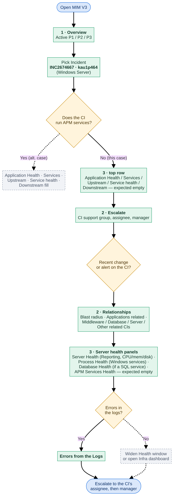
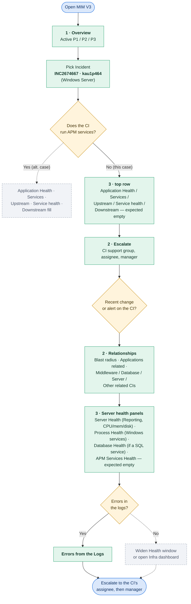

# MIM V3 — test case TC-02: investigate INC2674667 on kau1p464

| | |
|---|---|
| **Date** | 23 Oct 2026 |
| **Dashboard** | MIM V3, Kibana 9.5.3 |
| **Objective** | Show the dashboard's behaviour for the opposite case from TC-01: a server CI that sends **server
metrics but runs no APM services**. Confirms that the section 3 dependency panels stay empty rather than erroring,
while the server health panels still fill |
| **Why this incident** | Round 15 (`queries_ro_run.md`) ranked it top of the *Windows Server* class: metrics, a
database signal and Windows services, but no APM (`apm = 0`) |
| **Result** | **Pending.** Walk through the dashboard with the inputs below and send screenshots, the same way as
TC-01 (`testa.png` …), so this document can be filled in with the real results |

## How this differs from TC-01

TC-01 (`MIM-V3-TEST-CASE-INC2676403.md`) used a server that also ran two APM services, so every section 3 panel had
something to show. This test picks a server with **no APM**, which is the more common shape for a server-class
incident (Round 14/15: most server CIs with an incident carry no APM services at all). It checks that:
- the health panels (Server, Process, Database, Middleware) still fill from server metrics alone;
- the APM-dependent panels (Application Health, Services of the Application, Upstream, Service health, Downstream,
  APM Services Health) show **empty, not an error**;
- nothing needs picking in the Service or Application controls for the server panels to work.

## Test flow

The path this test is expected to follow. Not yet confirmed against the real dashboard — the labels describe what
*should* happen based on the CA query's signals (`metrics = 1`, `db = 1`, `win = 1`, `apm = 0`, `middleware = null`),
not an observed result.
- **Green:** the step and its expected result.
- **Amber:** a decision.
- **Grey, dashed:** the branch this test does not exercise (APM present — that's TC-01).

Flowchart source (Mermaid)

## Inputs

| Control | Value | Why |
|---|---|---|
| Incident | `INC2674667 · kau1p464` | The incident under test; its affected CI is kau1p464, a Windows server |
| CI | *(no CI selected)* | Not needed: an incident's CI always wins |
| Server | *(no server selected)* | Not needed: kau1p464 is itself a server, so the health panels should use it directly |
| Health window | 24 hours | Default; long enough to catch errors from before the incident |
| Service | *(services on this CI)* | No APM service expected on this CI, so nothing to pick |
| Application | *(all applications)* | No APM service on this CI, so no business application is driven by it |

If kau1p464 turns out **not** to be in the Server control's list (it should be, since it sends metrics), check
`vkau1pwb0003` (`INC2673019`) instead — the variant in *MIM-V3-TEST-CASES.md*.

---

## What to capture

Walk through the dashboard with the inputs above, the same way as TC-01: a screenshot per step below, named
`tc02a.png`, `tc02b.png` … Upload them and this document will be filled in with the real results (✅ / ❌ per row)
and the flowchart updated with the actual figures.

## Step 1 — Major Incident Overview

**What to show:** the starting point, unrelated to this CI — confirms section 1 still works the same as in TC-01.

*(tc02a.png — section 1: controls, donut, time to resolve, active incidents)*

| Check | Expected |
|---|---|
| Controls hold the inputs above | — |
| *Active P1 / P2 / P3* donut renders | — |
| *User base · ServiceNow* / *Real users · RUM*: both "In progress" | — |
| *Active Incidents*: `INC2674667` appears, priority P3 | — |

## Step 2 — Escalate, Changes and Alerts

**What to show:** who owns kau1p464, and whether anything changed or alerted on it recently.

*(tc02b.png — Escalate, Changes in the Last 7 Days, Alerts on this CI)*

| Check | Expected |
|---|---|
| *Escalate*: kau1p464 · INC2674667 · P3 · Windows Server · prod, with a support group, assignee and manager | — |
| *Changes in the Last 7 Days*: empty or shows a change, depending on real data | — |
| *Alerts on this CI*: empty or shows a Netcool alert — CA found none for this CI in the last 7 days | expect empty |

## Step 3 — The CI's relationships

**What to show:** the CMDB links around kau1p464 — what depends on it and what it runs on.

*(tc02c.png — Blast radius, Applications related to this CI, Middleware View, Database View)*

| Check | Expected |
|---|---|
| *Blast radius*: however many applications are linked, if any | — |
| *Applications related to this CI*: CA found no business application link for this CI (round 15 CA shows it only in the *Windows Server* class row, no application column) — likely empty or small | — |
| *Middleware View*: CA found no Paladin-labelled middleware (`middleware = null`) — likely empty | expect empty |
| *Database View*: CA flagged `db = 1`; this is often a database-engine-named Windows service rather than a CMDB database link, so this panel may still be empty | — |

*(tc02d.png — Server View, Other related CIs)*

| Check | Expected |
|---|---|
| *Server View*: the ESX host (if virtualised) or other servers it's linked to | — |
| *Other related CIs*: batch jobs, disks, or other CMDB links | — |

## Step 4 — Application and service health (expected empty)

**What to show:** that the APM-dependent part of section 3 degrades gracefully with no data, rather than erroring.

*(tc02e.png — section 3 top row: controls, Application Health, Services of the Application, Upstream, Service
health, Downstream)*

| Check | Expected |
|---|---|
| *Application Health*: no row for a CMDB-linked application on this CI (unless one exists that wasn't visible to
  the CA query) | expect empty or unrelated |
| *Services of the Application*: empty — no APM service runs on kau1p464 | expect empty |
| *Upstream*, *Service health*, *Downstream*: empty — the Service control finds no "(services on this CI)" match | expect empty |

**This is the main thing TC-02 tests:** that these five panels show "No results found" cleanly, with no query
error, when the CI has server metrics but no APM coverage.

## Step 5 — The server's health

**What to show:** that the health panels work from server metrics alone, with no APM needed.

*(tc02f.png — Middleware Health, Database Health, Server Health, APM Services Health, Process Health, Synthetics
Health)*

| Check | Expected |
|---|---|
| *Server Health*: one row for kau1p464, Reporting, with CPU / memory / disk percentages | expect filled |
| *Process Health*: kau1p464's Windows services, Stopped ones first | expect filled (CA found `win = 1`) |
| *Database Health*: filled if a SQL-named Windows service is detected, otherwise empty | — |
| *Middleware Health*: empty — no Paladin-labelled process found | expect empty |
| *APM Services Health*: empty — no APM service on this CI | expect empty |
| *Synthetics Health*: filled only if a monitor targets this CI, otherwise empty | — |

## Step 6 — Logs and related dashboards

**What to show:** whatever log signal exists for this CI, and the links out.

*(tc02g.png — Errors from the Logs, Related dashboards)*

| Check | Expected |
|---|---|
| *Errors from the Logs*: warning-and-worse lines for kau1p464, if any were collected | — |
| Links to the Applications Operations and Infra dashboards | expect present |

---

## Outcome

*To fill in once the screenshots are reviewed.* The expected conclusion: kau1p464's own health (Server, Process,
and possibly Database Health) tells the story, with no APM signal available — escalate using the CI support group
and assignee shown in *Escalate*, the same pattern as TC-01 but without an application-health angle.

## Observations to follow up

*To fill in from the screenshots — this is also where to flag anything that doesn't match the "Expected" column
above, since those predictions are untested.*
