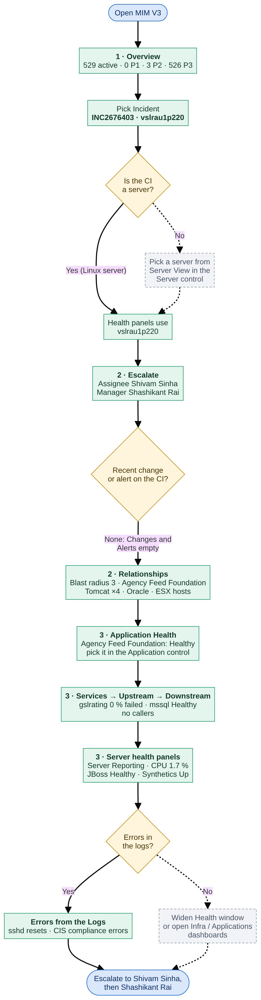
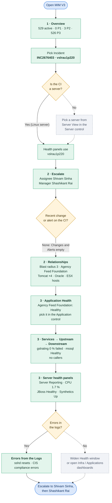

# MIM V3 — test case TC-01: investigate INC2676403 on vslrau1p220

| | |
|---|---|
| **Date** | 19–20 Oct 2026 |
| **Dashboard** | MIM V3, Kibana 9.5.3 |
| **Objective** | Show that picking one incident points the whole dashboard at it: the overview, the affected CI, its applications and services, its server's health, and who to escalate to |
| **Why this incident** | Round 12 ranked it first. Its CI is a monitored Linux server with 2 APM services, JBoss, logs, synthetic monitors and rich CMDB links, so almost every panel has something to show |
| **Result** | **Pass.** 23 of 28 panels filled; the 5 empty ones have no data for this CI, as expected |

## How the dashboard is read

The dashboard is read top to bottom, like an investigation:
1. **Section 1:** what is open right now, across all incidents.
2. **Section 2:** what the affected CI is, who owns it, and what it is connected to.
3. **Section 3:** how its applications, services and server are doing.

The controls at the top decide what sections 2 and 3 show. Picking an incident is enough: its CI drives
everything.

## Test flow

The path followed in this test, with what each step showed.
- **Green:** the step and its result.
- **Amber:** a decision.
- **Grey, dashed:** the branch this test did not need.

Flowchart source (Mermaid)

## Inputs

| Control | Value | Why |
|---|---|---|
| Incident | `INC2676403 · vslrau1p220` | The incident under test; its affected CI is vslrau1p220 |
| CI | *(no CI selected)* | Not needed: an incident's CI always wins |
| Server | *(no server selected)* | Not needed: vslrau1p220 is itself a server, so the health panels use it |
| Health window | 24 hours | How far back the health panels look; long enough to catch errors from before the incident |
| Service | `gslrating` | One of the two APM services on this server; drives Upstream / Service health / Downstream |
| Application | `Agency Feed Foundation` | The business application of those services; drives *Services of the Application* |

---

## Step 1 — Major Incident Overview

**What to show:** the starting point for the MIM lead. Before picking anything, section 1 answers "how bad is it
across the estate?"

| Check | Result |
|---|---|
| Controls hold the inputs above | ✅ |
| *Active P1 / P2 / P3*: 529 active (P1 0, P2 3, P3 526) | ✅ |
| *Time to Resolve vs Target*: P1 / P2 on the left axis, P3 on the right axis, dashed targets | ✅ |
| *Active Incidents*: SLA, assignee and manager per incident | ✅ |
| *Users impacted*: demo number (2,500) | ✅ placeholder |

**Notes:**
- **Donut:** no P1 is open; most of the load is P3.
- **Time to Resolve:** points above a dashed line missed their target (P1 4 h, P2 8 h, P3 24 h).
- **Active Incidents:** "Breached (age)" means there is no ServiceNow SLA record, so the incident's age is compared
  with the target. The table also gives the assignee and manager to chase.
- **Users impacted:** waiting for ServiceNow / RUM data. Treat the number as a placeholder.

## Step 2 — Open alerts and escalation

**What to show:** alerts that nobody has raised an incident for, then who owns our CI.

| Check | Result |
|---|---|
| *Open Alerts with No Incident*: open Netcool alerts on CIs with no open incident | ✅ |
| *Escalate*: vslrau1p220 · INC2676403 · P3 · Linux Server · prod; assignee **Shivam Sinha**, manager **Shashikant Rai** | ✅ |
| *Changes in the Last 7 Days*: empty | ✅ expected (no changes on this CI) |

**Notes:**
- **Open Alerts with No Incident:** shows possible blind spots, e.g. switches down for 7 days with no ticket. Worth
  a look even when you're focused on one incident.
- **Escalate** answers "who do I call?" in one row: the CI's support group, the incident's assignee, and their
  manager.
- **Changes empty** rules out a recent change on this CI as the cause.

## Step 3 — The CI's relationships

**What to show:** what depends on the server and what it depends on, straight from the CMDB.

| Check | Result |
|---|---|
| *Alerts on this CI*: empty | ✅ expected (no Netcool alerts on this CI) |
| *Blast radius*: 3 (1 business application, 2 application services) | ✅ |
| *Applications related to this CI*: Agency Feed Foundation, Agency Feed Foundation PROD, FAMUS-R PROD | ✅ |
| *Middleware View*: 4 Tomcat instances (one marked retired) | ✅ |
| *Database View*: Oracle instance agenp@sau1h688 | ✅ |

**Notes:**
- **Blast radius** is amber at 1 or more, red at 5: if this server fails, 3 applications are affected.
- **Applications related** spells out each relationship ("it runs on this CI", "it depends on this CI"). This is
  how *Agency Feed Foundation* was found for the Application control.
- **Middleware / Database views** come from CMDB records, not live health. The database lives on another server
  (sau1h688), which is worth checking if the application is slow.

| Check | Result |
|---|---|
| *Server View*: the ESX hosts it runs on | ✅ |
| *Other related CIs*: batch jobs, disks, cluster rule | ✅ |
| *SLO Error Burn Rate*: burning SLOs (no ★ row: the CI has no SLO of its own) | ✅ |

**Notes:**
- **Server View** lists the ESX hosts the server is virtualised on: the next place to look if the VM itself
  misbehaves.
- **Other related CIs** catches everything else, e.g. batch jobs that run on the server and its disks. So no CMDB
  link is hidden.
- **SLO Error Burn Rate** is estate-wide: SLOs burning their error budget now. A ★ would mark an SLO of this CI.

## Step 4 — Application and service health

**What to show:** whether the applications on this server are healthy, from APM, over the last hour.

| Check | Result |
|---|---|
| *Application Health*: Agency Feed Foundation Healthy, 3 services, with its servers | ✅ |
| *Services of the Application*: fmrsmartapp, gslrating, smartapp, all Healthy, with servers | ✅ |
| *Upstream*: gslrating depends on mssql (35 calls, Healthy) | ✅ |
| *Service health*: gslrating, 0.0 % failed | ✅ |
| *Downstream*: empty | ✅ expected (no HTTP callers in the last hour) |

**Notes:**
- **Application Health** rolls each application up from its services: Failing at 10 % failed transactions or more,
  Degraded at 1 % or more.
- **The *Servers* column** shows where each service runs (here vslrau1p219, vslrau1p220 …). Typing one into the
  **Server** control moves the health panels to that server.
- **Read the dependency row left to right:** what gslrating depends on (mssql) → gslrating itself → who calls it.
  Everything is green, so the application is not affected right now.

## Step 5 — The server's health

**What to show:** the server's own health over the Health window: the infrastructure view of the incident.

| Check | Result |
|---|---|
| *Middleware Health*: 2 JBoss instances + 1 unlabelled process, all Healthy | ✅ |
| *Database Health*: empty | ✅ expected (no database on this server) |
| *Server Health*: Reporting; CPU p90 1.7 %, memory 58.7 %, disk 53 % | ✅ |
| *APM Services Health*: gslrating, agencyfeedfoundation, data 0 min ago | ✅ |
| *Process Health*: 3 middleware processes Running | ✅ |
| *Synthetics Health*: 3 monitors Up, 0 down checks | ✅ |

**Notes:**
- **Server Health** turns amber at 80 %, red at 90 %, and "Silent" after 10 minutes without data. Here all three
  values are green and it is reporting.
- **Middleware / Process Health** put stopped or silent components first. None here.
- **Synthetics** checks the server from outside: ping and TCP ports 8445 / 8448 are up. So it is reachable.
- **Health window:** set it to 15 minutes to see the state *now*, or to 7 days to look further back.

## Step 6 — Logs and related dashboards

**What to show:** the only place this incident shows any signal.

| Check | Result |
|---|---|
| *Errors from the Logs*: critical sshd and CISCHK_ERROR lines from redhat6x-syslog, grouped with counts | ✅ |
| *Business applications impacted*: empty | ✅ expected (no callers, as in *Downstream*) |
| Links to the Applications Operations and Infra dashboards | ✅ |

**Notes:**
- **Errors from the Logs** groups repeated messages: numbers become `#`, so one error shows once with a count.
  Compare *First seen* with the incident's opened time.
- **What the logs show:** sshd connection resets (13:21) and CIS compliance-check errors (01:38). Likely the
  incident's subject, or noise for the assignee to confirm.
- **Related dashboards** open the full Applications Operations and Infra views for deeper digging.

---

## Outcome

- **Server and applications are healthy now.** The server is reporting with low CPU and memory, its services have
  no failed transactions, and its monitors are up.
- **The only signals are in the logs:** sshd connection resets and CIS compliance errors.
- **Escalate to:** Shivam Sinha (assignee), then Shashikant Rai (manager); both are named in *Escalate*.

## Observations to follow up

- *Middleware Health* and *Process Health* list a process labelled **unknown**: the monitoring enrichment gives it no
  type.
- *SLO Error Burn Rate*: **[Sumukha] llap-Document-Api Latency** burns at about 100,000×, which suggests a
  misconfigured SLO.
- Long values (*Servers*, *Application*) are cut off at the default column widths. Hover over a cell to see the full
  value.
