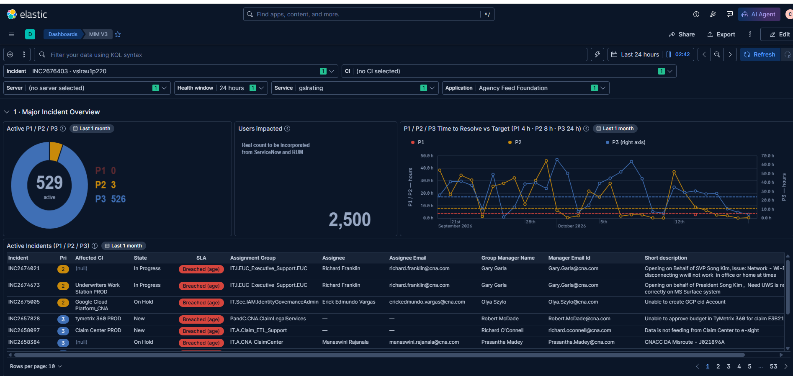
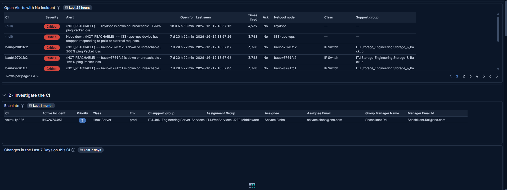
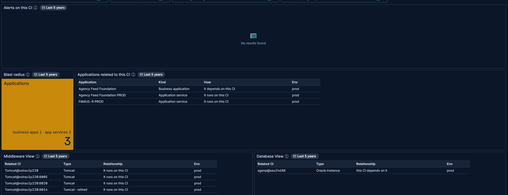
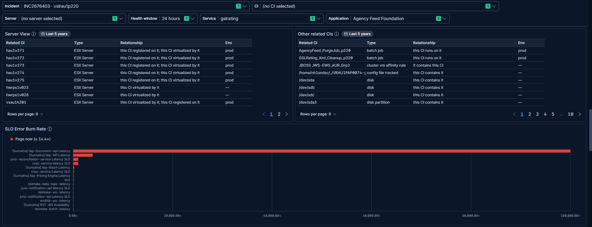
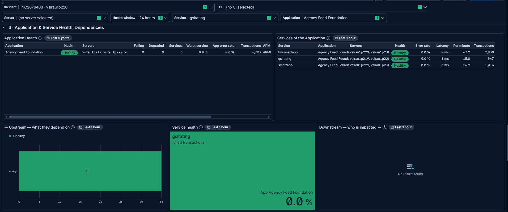
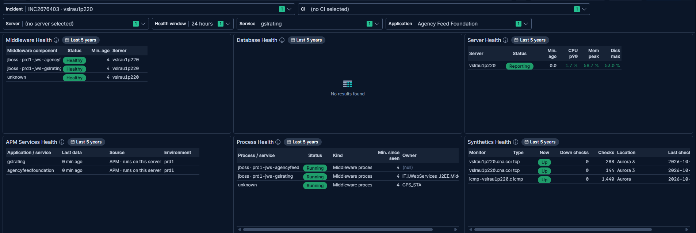
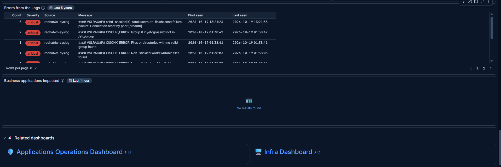

# MIM V3 — test case TC-01: investigate INC2676403 on vslrau1p220

| | |
|---|---|
| **Date** | 19–20 Oct 2026 |
| **Dashboard** | MIM V3, Kibana 9.5.3 |
| **Objective** | Pick one incident and check that every panel follows it: overview, the CI, its applications and services, its server's health, escalation |
| **Why this incident** | Round 12 ranked it first: its CI is a monitored Linux server with 2 APM services, JBoss, logs, synthetics and rich CMDB links |
| **Result** | **Pass.** 23 of 28 panels filled; the 5 empty ones have no data for this CI, as expected |

## Inputs

| Control | Value |
|---|---|
| Incident | `INC2676403 · vslrau1p220` |
| CI | *(no CI selected)*: the incident's CI is used |
| Server | *(no server selected)*: vslrau1p220 is a server, so it's used |
| Health window | 24 hours |
| Service | `gslrating` |
| Application | `Agency Feed Foundation` |

---

## Step 1 — Major Incident Overview

| Check | Result |
|---|---|
| Controls hold the inputs above | ✅ |
| *Active P1 / P2 / P3*: 529 active (P1 0, P2 3, P3 526) | ✅ |
| *Time to Resolve vs Target*: P1 / P2 left axis, P3 right axis, dashed targets | ✅ |
| *Active Incidents*: SLA, assignee and manager per incident | ✅ |
| *Users impacted*: demo number (2,500) | ✅ placeholder |

## Step 2 — Open alerts and escalation

| Check | Result |
|---|---|
| *Open Alerts with No Incident*: open Netcool alerts on CIs with no open incident | ✅ |
| *Escalate*: vslrau1p220 · INC2676403 · P3 · Linux Server · prod; assignee **Shivam Sinha**, manager **Shashikant Rai** | ✅ |
| *Changes in the Last 7 Days*: empty | ✅ expected (no changes on this CI) |

## Step 3 — The CI's relationships

| Check | Result |
|---|---|
| *Alerts on this CI*: empty | ✅ expected (no Netcool alerts on this CI) |
| *Blast radius*: 3 (1 business application, 2 application services) | ✅ |
| *Applications related to this CI*: Agency Feed Foundation, Agency Feed Foundation PROD, FAMUS-R PROD | ✅ |
| *Middleware View*: 4 Tomcat instances (one marked retired) | ✅ |
| *Database View*: Oracle instance agenp@sau1h688 | ✅ |

| Check | Result |
|---|---|
| *Server View*: the ESX hosts it runs on | ✅ |
| *Other related CIs*: batch jobs, disks, cluster rule | ✅ |
| *SLO Error Burn Rate*: burning SLOs (no ★ row: the CI has no SLO of its own) | ✅ |

## Step 4 — Application and service health

| Check | Result |
|---|---|
| *Application Health*: Agency Feed Foundation Healthy, 3 services, with its servers | ✅ |
| *Services of the Application*: fmrsmartapp, gslrating, smartapp, all Healthy, with servers | ✅ |
| *Upstream*: gslrating depends on mssql (35 calls, Healthy) | ✅ |
| *Service health*: gslrating, 0.0 % failed | ✅ |
| *Downstream*: empty | ✅ expected (no HTTP callers in the last hour) |

## Step 5 — The server's health

| Check | Result |
|---|---|
| *Middleware Health*: 2 JBoss instances + 1 unlabelled process, all Healthy | ✅ |
| *Database Health*: empty | ✅ expected (no database on this server) |
| *Server Health*: Reporting; CPU p90 1.7 %, memory 58.7 %, disk 53 % | ✅ |
| *APM Services Health*: gslrating, agencyfeedfoundation, data 0 min ago | ✅ |
| *Process Health*: 3 middleware processes Running | ✅ |
| *Synthetics Health*: 3 monitors Up, 0 down checks | ✅ |

## Step 6 — Logs and related dashboards

| Check | Result |
|---|---|
| *Errors from the Logs*: critical sshd and CISCHK_ERROR lines from redhat6x-syslog, grouped with counts | ✅ |
| *Business applications impacted*: empty | ✅ expected (no callers, as in *Downstream*) |
| Links to the Applications Operations and Infra dashboards | ✅ |

---

## Outcome

- **Server and applications are healthy now.** The server is reporting with low CPU, and its services have no errors.
- **The only signals are in the logs:** sshd connection resets and CIS compliance errors.
- **Escalate to:** Shivam Sinha (assignee), then Shashikant Rai (manager).

## Observations to follow up

- *Middleware Health* and *Process Health* list a process labelled **unknown**: the monitoring enrichment gives it no
  type.
- *SLO Error Burn Rate*: **[Sumukha] llap-Document-Api Latency** burns at about 100,000×, which suggests a
  misconfigured SLO.
- Long values (*Servers*, *Application*) are cut off at the default column widths. Hover over a cell to see the full
  value.
