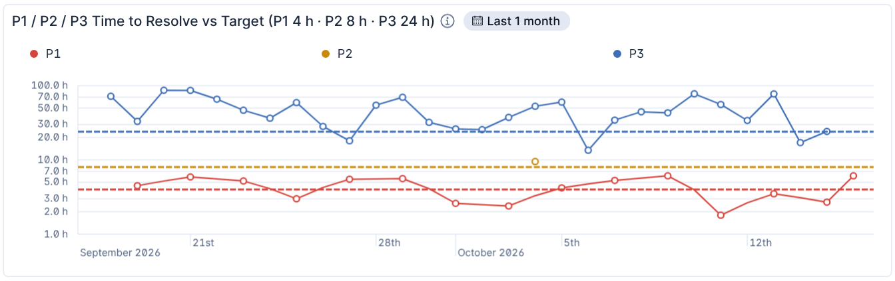
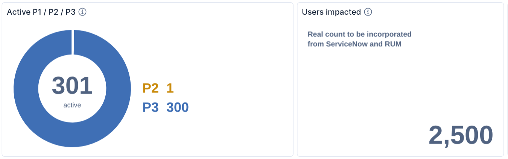
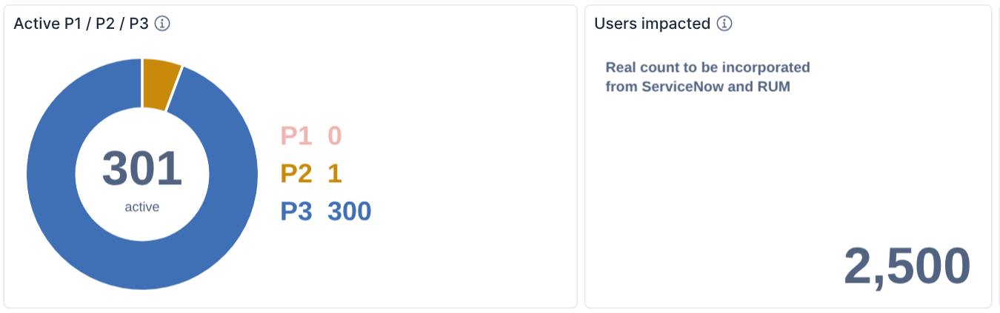
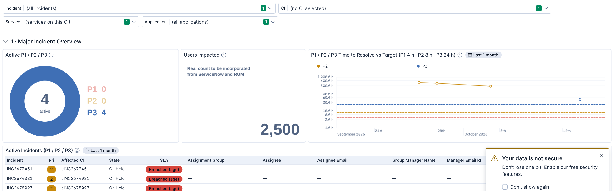
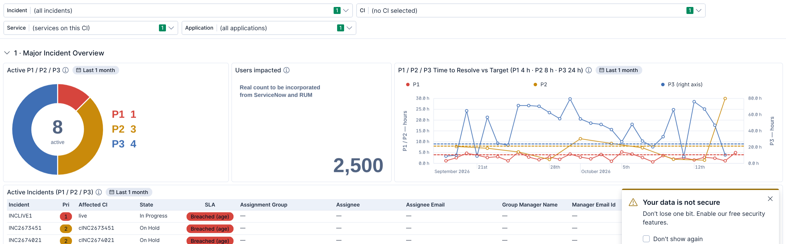

# MIM V3 — P3 target, Time to Resolve fix and donut fix (16 Oct 2026)

> **Update, later 16 Oct:** parts 2 and 4 were not the whole story. The real cause of the donut problem and the
> new axis design are in **part 5**.

Pushed to main. To see the changes on the cluster: import `MIM V3.ndjson` (overwrite), then **More → Reset
changes** and reload.

## 1. Why the live P1 did not show on Time to Resolve

There were two causes:

1. **The chart only plotted resolved incidents.** An open P1 had no point at all until it was resolved.

   Now an open incident counts with its **age so far**: it appears on the day it was opened, and its point keeps
   climbing past the target while it stays open. In the preview below, it is the red point at the far right.
2. **Kibana could hide a lone point.** A priority with incidents on one day only is a single point with no line, and
   Kibana's default "auto" point setting can hide it. Points are now always drawn.

While fixing this I found a counting error: an incident synced several times used to count once per copy in that
day's average. Each incident now counts once, and canceled incidents are left out.

## 2. P3 added to the chart

The chart is now **"P1 / P2 / P3 Time to Resolve vs Target (P1 4 h · P2 8 h · P3 24 h)"**, with a blue dashed 24 h
line.

*(Replaced in part 5: the log axis cut off values under 1 h; the chart now has two axes from 0 h.)* The time axis was made **logarithmic**. I rendered it both ways: on a normal axis, P3 values of a day or more flatten the
P1 and P2 lines against the bottom, so you cannot read them. If you prefer the normal axis, it is a one-word change
(`linear` as the third argument of `tools/mim_v3_patch_2026-10-16e.py`).



*Test data: a live P1 opened 6 h ago (far right, above its 4 h line), and a P2 resolved on one day only (the single
amber point).*

## 3. P3 in the SLA column

A P3 with no ServiceNow SLA record is now compared with **24 h** and marked "(age)", like P1 4 h and P2 8 h.
"No SLA record" is gone.

## 4. The donut showed only P3

Seen live: the Active Incidents table had active P2 and P3 incidents, but the *Active P1 / P2 / P3* donut showed only
P3.

**Cause.** There are usually far more P3s than P2s. The donut leaves a small gap between slices, and a slice thinner
than that gap is not drawn. I reproduced it with 1 P2 next to 300 P3s: the legend says "P2 1", but the ring is solid
blue.

| Before | After |
|---|---|
|  |  |

**Fix.**
- Every priority with at least one active incident gets a slice of **at least 6 % of the ring**. The numbers beside
  the ring, and the hover text, stay the real counts.
- The legend **always lists P1, P2 and P3**, with 0 shown faded. A priority with no incidents used to disappear
  instead of reading 0.
- The donut now uses **exactly the same active-incident rule as the Active Incidents table**: the number starts with
  "INC", and the priority and state are converted the same way. The two panels can no longer count different
  incidents, even if a field is stored differently in some indices.

**To confirm on the cluster (optional data query).** Run this in Discover (ES|QL mode). If it shows P2 incidents, but
only a few compared with P3, the hidden slice was the cause, and the fix above solves it:

```
FROM servicenow-incidents-*
| WHERE @timestamp >= NOW() - 1 month
| EVAL pri = TO_INTEGER(priority), state = TO_STRING(state_name)
| WHERE TO_STRING(number) LIKE "INC*" AND pri IN (1, 2, 3)
    AND state NOT IN ("Resolved", "Closed", "Canceled", "Cancelled")
| STATS active_incidents = COUNT_DISTINCT(number) BY pri
| SORT pri
```

## 5. Second look (later 16 Oct): the real donut cause, and axes from 0 h

Reported with `bad_donut.png`:
- the donut read **P2 0**, while the Active Incidents table listed active P2s (all On Hold);
- the Time to Resolve log axis started at 1.0 h and cut off lines that went below it.

### The donut: Kibana 9.5 applies the dashboard's time range to Vega

Part 4's hidden-slice fix was real, but it was not what your screenshot showed. The legend itself said P2 0, so the
query was returning no P2s.

**Cause.** In **Kibana 9.5**, a Vega panel's ES|QL query gets the dashboard's time range applied automatically, on the
`@timestamp` field Kibana finds for it. Kibana 9.4, which I had been testing on, does not do this; I found it by
reading 9.5.3's Vega code. Your dashboard was on **Last 24 hours**, so the donut only counted incidents whose record
was updated in the last 24 hours. The P2s had been On Hold for days without updates. The table has its own fixed
range, **Last 1 month**, so it still listed them.

**Reproduced on Kibana 9.5.3** (pulled from Docker Hub) with three On Hold P2s last updated 3–10 days ago and four P3s
updated in the last hour, dashboard on Last 24 hours:



**Fix.** The donut now has the same fixed panel time range as the table, **Last 1 month** (the badge shows next to its
title). Both panels count the same incidents, whatever the time picker says.



I also checked the **Incident control** on 9.5.3: it lists incidents not updated in the last 24 hours, so the controls
are not affected.

> **Still to know:** both panels only count incidents whose record was updated in the last month. An incident left On
> Hold with no update for over a month is missing from both. If that happens at CNA, the range can be widened.

### Time to Resolve: both axes start at 0 h

- The log axis could not show values under 1 h, so lines dipping below it were cut off. It is replaced by normal axes
  that **start at 0 h**.
- **P1 and P2 use the left axis**, with their 4 h and 8 h targets. **P3 has its own right axis**, also from 0 h, with
  its 24 h target. On a single axis, P3 values of a day or more would flatten the P1 and P2 lines again.
- The axis titles say which side is which, and the legend reads "P3 (right axis)".
- **Trade-off:** a P2 left open for many days still stretches the left axis while it is open, because open incidents
  count with their age so far.

## Checks

- All seven tests in `tools/` pass, in any order. Two are new:
  - `test_mim_v3_2026-10-16e.py`: an incident synced three times counts once, the live P1 is plotted by its age, and
    canceled and P4 incidents are left out.
  - `test_mim_v3_2026-10-16f.py`: the donut and the table give the same counts, and duplicates, a resolved P2, a P4
    and a non-incident number are left out.
- Parts 1–4 were checked in Kibana 9.4. Part 5 was checked on **Kibana / Elasticsearch 9.5.3**, the cluster's
  version: all eight tests pass, and every link column is a real field on 9.5.3.
- Running the patch scripts on the colleague's export rebuilds `MIM V3.ndjson` byte for byte.
- Updated: the guide, the walkthrough, the SLA rules (*MIM-V3-SLA-CALCULATION.md*), the 16 Oct summary and
  `tools/README.md`.
