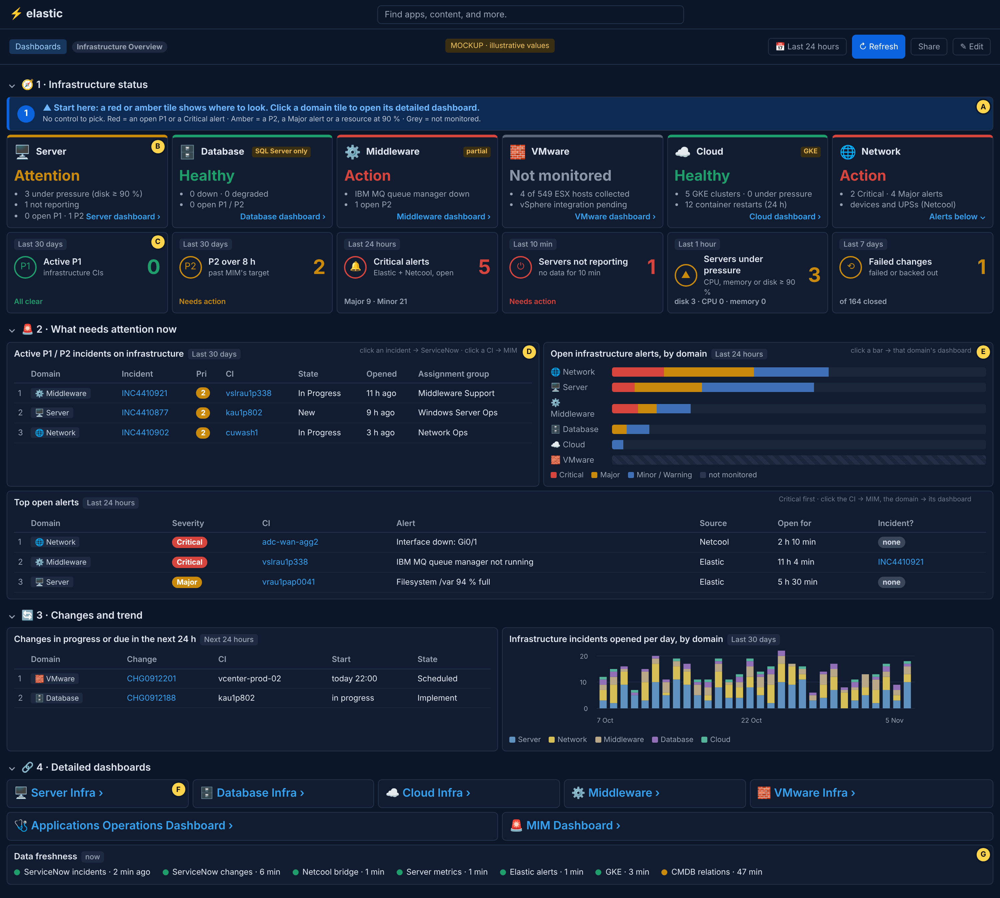
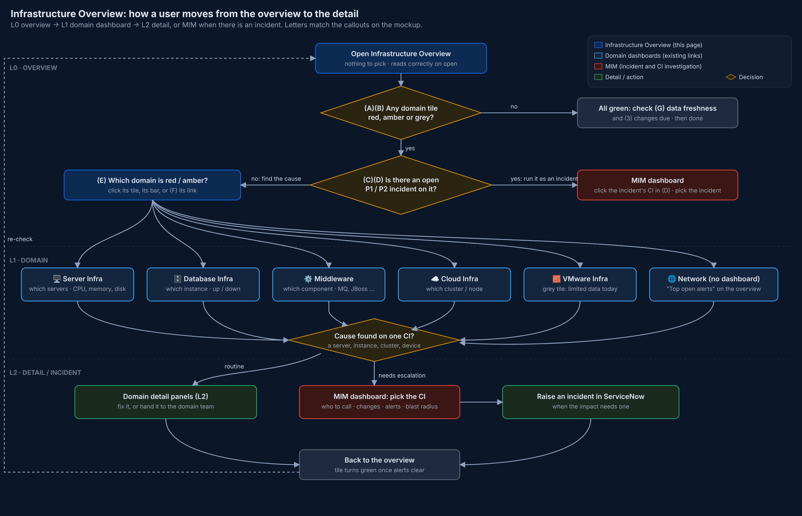

# Infrastructure Overview: mockup and usage flow

*6 Nov 2026. A preview before building. Values in the mockup are illustrative. KPIs: `../INFRA-OVERVIEW-KPIS.md`.*

## What carries over from our dashboards

The same look as MIM V5 and the Infrastructure Dashboard: dark Kibana theme, numbered sections with icons
(🧭 🚨 🔄 🔗), a blue numbered "Start here" banner, tiles with an icon that are **green at 0** and coloured by priority
or severity above it, a time badge on every panel (its fixed window), row numbers in tables, ServiceNow links on
incident numbers, CI links to MIM, and the row of detailed-dashboard links. **New:** no control to pick, and a status
tile per domain.

## The page, section by section (letters match the yellow callouts)

**🧭 1 · Infrastructure status**
- **(A) Start here banner.** Says how to read the page: red = an open P1 or a Critical alert, amber = a P2, a Major
  alert or a resource at 90 %, grey = not monitored.
- **(B) Domain status tiles** (KPI 1). One per domain: Server, Database, Middleware, VMware, Cloud, Network. Each
  shows its status, the two or three facts behind it, and a link to its detailed dashboard. Partial coverage is
  labelled on the tile (*SQL Server only*, *partial*, *GKE*); VMware is grey, *Not monitored*, until the vSphere
  integration is extended. Network has no dashboard yet, so its link jumps to the alerts below.
- **(C) KPI tiles** (KPIs 2–5, 12): Active P1, P2 over 8 h (MIM's rule), Critical alerts, Servers not reporting,
  Servers under pressure, Failed changes.

**🚨 2 · What needs attention now**
- **(D) Active P1 / P2 incidents on infrastructure**, with their domain. Click the incident → ServiceNow; click the CI
  → MIM with that CI picked.
- **(E) Open infrastructure alerts, by domain**: a bar per domain split by severity (KPI 3). Click a bar → that
  domain's dashboard.
- **Top open alerts**: Critical first, with whether an incident exists. Click the CI → MIM.

**🔄 3 · Changes and trend**: changes in progress or due in 24 h (KPI 11); incidents opened per day by domain, 30 days
(KPI 13).

**🔗 4 · Detailed dashboards**
- **(F) Links**: the seven dashboards already on the page.
- **(G) Data freshness** (KPI 16): when each feed last delivered. Amber or red means the tiles that use it may be wrong.

## Walkthrough: from the overview to the detail

1. **Open the Infrastructure Overview.** Nothing to pick: every panel reads correctly on open.
2. **Scan the domain tiles (B).**
   - **All green:** glance at *Data freshness* (G), so green means green, and at *Changes due* (section 3). Done.
   - **Grey (VMware):** the domain isn't monitored. Open its dashboard for what data there is.
   - **Red or amber:** go on.
3. **Is there an open P1 / P2 on it?** Look at the tile's facts and the incidents table (D).
   - **Yes:** it is an incident. Click the CI in (D) to open **MIM** with that CI picked, then pick the incident in
     MIM's Incident control: who to call, what changed, what is alerting, the blast radius.
   - **No:** find the cause in the domain (step 4).
4. **Open the domain's detailed dashboard (L1):** click its tile, its bar in (E), or its link (F).

   | Tile | Dashboard | What you look for there |
   |---|---|---|
   | 🖥️ Server | Server Infra | Which servers: CPU, memory, disk, not reporting |
   | 🗄️ Database | Database Infra | Which instance is down or slow |
   | ⚙️ Middleware | Middleware | Which component: IBM MQ, JBoss, WebSphere, IIS |
   | ☁️ Cloud | Cloud Infra | Which cluster or node; restarts |
   | 🧱 VMware | VMware Infra | Limited data until the integration is extended |
   | 🌐 Network | *(no dashboard yet)* | *Top open alerts* on the overview, then MIM for the device |

5. **Cause found on one CI (L2):**
   - **Routine** (a disk filling, a stopped service): fix it, or hand it to the domain team from the domain
     dashboard.
   - **Needs escalation:** open **MIM** with the CI picked for owners and impact, and raise an incident in
     ServiceNow if the impact needs one.
6. **Back to the overview.** The tile turns green once its alerts clear and its incidents close.

## Notes for the build

- **Clicking a tile:** Kibana opens a link from a metric tile through a URL drill-down (as our incident links do),
  or from a Markdown or Links panel. Each tile keeps a visible "… dashboard ›" link, so the target is never hidden.
- **CI → MIM with the CI picked:** a URL drill-down can open MIM, but Kibana 9.5 cannot set MIM's CI control from a
  URL for an ES|QL control. The link opens MIM and the user types the CI (shown in the tooltip). To check during the
  build.
- **Domain of a CI:** from the CMDB class (`ci.class_name`), with the class → domain table the team agrees.
